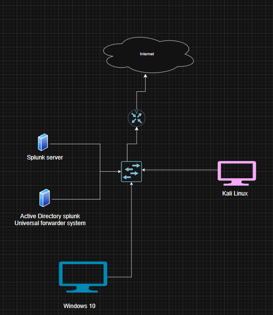

Active Directory Proeject

Active Directory is a centralized database that stores and manages information about users, computers, and groups within a network. It allows administrators to organize and control access to network resources. To use Active Directory, a server must have the Active Directory Domain Services (AD DS) role installed and then be promoted to a Domain Controller. Once promoted, the server can handle authentication using the Kerberos protocol and manage authorization by applying policies and permissions across the domain.

During this project, I also had to troubleshoot several issues while setting up and connecting systems. These included fixing network configuration problems, adjusting static IP settings, resolving domain join errors, and ensuring that services like DNS and AD DS were running properly. These troubleshooting steps helped deepen my understanding of how Active Directory functions and how to solve real-world problems in a networked environment.

Lab Setup and Planning

To get started, I created a basic network diagram using draw.io
This helped me plan out how all the parts of my lab would connect and work together.

My lab included:

> Windows Server — this was my domain controller that ran Active Directory.

> Windows 10 PC — a regular computer that would join the domain.

> Kali Linux — used to test security by trying different attacks.

> Splunk Server — collected and showed logs from other devices.

> Splunk Universal Forwarder — sent logs from Windows machines to Splunk.

> Sysmon — added extra logging on Windows to track system activity.

> Router and Internet — used to simulate a real network.

This diagram made it easier to understand what I needed and how each machine would talk to the others.

Virtual Machine Setup
I used Oracle virtual box to install four virtual machines on my computer, each with a different role

Windows 10 was the target machine, acting like a regular user computer.

Kali Linux was the attacker machine, used for testing and hacking tools.

Windows Server 2022 was set up to run Active Directory, which manages users and network rules.

Ubuntu Server ran Splunk, which collects and shows logs from all machines.
What is Active Directory?

(Active directory) is a system that helps manage users, computers, and access in a network.

It uses AD DS (Active Directory Domain Services) to store a database of objects like users, computers, and groups.

Each object has attributes, which are pieces of information such as names, passwords, and roles.

In short:

>Windows 10 = target
Kali Linux = attacker

>Windows Server 2022 = runs Active Directory

>Ubuntu Server = runs Splunk

>All of this was set up using VirtualBox for safe testing.

Setting Up Splunk on Ubuntu Server
To set up Splunk on the Ubuntu Server, I first installed VirtualBox Guest Additions so I could use a shared folder between my host computer and the Ubuntu virtual machine. This made it easier to move files. After that, I created a new Netplan configuration file to give the Ubuntu server a static IP address. This was important so that both the Windows 10 target machine and the Windows Server 2022 could reliably connect to it over the network.

Installing Sysmon and Splunk Forwarder
On the Windows 10 machine, I accessed the Splunk web interface by logging into my Splunk account using the server’s IP address. Then I installed Sysmon with a custom configuration file I found on GitHub. Before installing Sysmon, I had to download and install the Splunk Universal Forwarder. I edited the inputs.conf file so that all the logs from Sysmon would be sent to the Splunk server. I repeated this process on the Windows Server 2022 as well, so that both machines would forward their data.

Final Setup
After completing the setup on both machines, I was able to start seeing incoming data in my Splunk server. I created a new index named “Endpoint” where all the logs were stored. These logs included system activity from both the Windows 10 target machine and the Windows Server 2022. I could now view detailed information such as process creation, network connections, and other useful events collected by Sysmon.

Thanks to the static IP setup, the Splunk Forwarders on both machines were able to send data without any connection issues. This setup allowed me to monitor the behaviour of both systems in real time and made it easier to track anything suspicious or unusual happening in the network. My home lab environment is now able to log and analyse activity across all connected virtual machines through Splunk.

